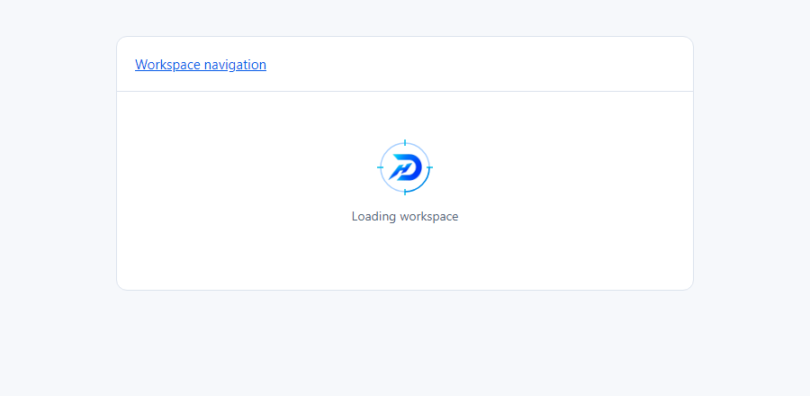

# Dashboard route startup acceptance

**Implemented for genuine dashboard route suspension. Targeted lifecycle and
browser checks and the new full repository gate pass. Design review is
still pending in draft PR #636.**

## Real Next boundary

The installed Next.js 16 loading guide was read before implementation:
`node_modules/next/dist/docs/01-app/03-api-reference/03-file-conventions/loading.md`.
It specifies that a segment loading file renders inside its layout and wraps page
children in Suspense. Shared layouts remain interactive; the fallback is replaced
when route content is ready. It does not cover blocking work in its own layout,
template, or error component.

`app/(dashboard)/loading.tsx` now returns the shared client `BrandStartupLoader`.
Next owns when this fallback mounts and unmounts. No global initialization state,
new fetch, auth barrier, promise, route delay, or full-screen overlay was introduced.
The component has normal centered flow layout without a viewport background.
Dashboard navigation remains outside the loading boundary. Existing nested route
skeletons retain responsibility for their own boundaries; they may handle a wait
without mounting this group fallback. The root server-side account/redirect wait
remains separate.

This supersedes the earlier absence finding at runtime commit `03612d61` and
documentation commit `711a955c`. There is still no invented app-wide initialization
stage: the eligible stage is actual Next route-child suspension.

## Lifecycle contract

| Requirement                       | Implemented behavior and evidence                                                                                                              |
| --------------------------------- | ---------------------------------------------------------------------------------------------------------------------------------------------- |
| Immediate neutral feedback        | One live status announces “Loading workspace”; the same visible label remains neutral throughout                                               |
| Shared anti-flash guard           | Existing shared artwork stays hidden below 200 ms; no request or content is delayed                                                            |
| Reserve 64 px                     | A fixed 64 × 64 px artwork slot remains the same size while hidden, compact, animated, capped, or repeated                                     |
| First eligible fallback only      | Session key `dealerhunt:dashboard-route-startup:v1` is claimed on first mounted fallback; a fast unmount also consumes that opportunity        |
| Storage blocked                   | A module flag prevents replay within the same JS document, including storage getter/read/write failures                                        |
| 1300 ms cap                       | Deadline starts on client fallback mount; animation is disabled at 1300 ms, with the mark and neutral pending text retained                    |
| Still genuinely pending after cap | The shared loader stays in `state="loading"`; there is no timer-driven completion, success text, or forced content reveal                      |
| Immediate usable content          | Next/React replaces the fallback immediately; there is no minimum duration or wait for the cap                                                 |
| Error route                       | Error-boundary replacement unmounts the fallback and clears timers immediately                                                                 |
| Repeat mount or document          | Subsequent fallback mounts are static; session storage also preserves that choice across reloads                                               |
| Reduced motion                    | All decorative animations are disabled by the existing media preference                                                                        |
| Static app motion                 | Explicit `motion="static"`, `html[data-motion="static"]`, and `html[data-app-motion="static"]` suppress motion, including live setting changes |
| Strict Mode                       | A single claim and deadline survive effect replay without skipping the first opportunity or extending the cap                                  |

The cap is measured from client mount, not delayed until the artwork appears:
with the 200 ms anti-flash guard, the first visual can animate for at most the
remaining 1100 ms. The pre-hydration/server-rendered visual is guarded and static.
The shared request-loader's compact sizing and generic indeterminate animation
remain unchanged. Its new static-motion option stops decoration without changing
request lifecycle state.

## Tests and evidence

`app/brand-startup-loader.test.tsx` has **10 passing tests** using the actual
boundary component/shared artwork and fake timers. These cover 199/200 ms and
1299/1300 ms, short readiness through a real React Suspense boundary, repeat
mounts after early completion, pre-existing session state, blocked reads/writes
and storage getters, explicit static mode, SSR, Strict Mode, and an error boundary
replacing a suspended route. They verify timer cleanup and never infer success
from elapsed time. Combined branding/request-lifecycle tests: **40 passed**.

`scripts/preview-brand-startup.mjs` mounts the actual dashboard loading component
in an isolated React Suspense route harness with usable navigation. Controlled
browser clocks verify the reserved slot, first animation, cap, repeat mounts,
reload persistence, fast ready content, error replacement, blocked storage, live
app-motion changes, and static/reduced-motion settings. Compiled helper bundles
stay in ignored `.cache`, outside source lint.

Local evidence under `test-results/dh-brand-review/`:

- `startup-tests.log` — 40 passing targeted tests across five files.
- `startup-browser-checks.json` and `startup-browser.log` — computed browser results.
- `startup-targeted-lint.log` — targeted component/test/helper lint, no errors.
- `startup-full-verify.log` — the new complete gate: passed (typecheck, lint, 5897 tests / 777 files, default production build).
- `startup-pending-200ms.png`, `startup-capped-1300ms.png`, `startup-reduced-motion.png`.
- `startup-motion.webm`.

The required new full gate passed in 1429.0 seconds, including 5897 tests across
777 files. The old 5887-test result is historical and was not substituted for this
implementation's gate. Next's generated client-reference manifests also include
BrandStartupLoader, recorded in startup-acceptance.json. The refreshed production
audit passed with zero high/critical findings. No merge or
deployment is authorized; PR #636 remains draft for design review.

## Review captures

[First pending visual at 200 ms](startup-pending-200ms.png) ·
[Reduced-motion pending visual](startup-reduced-motion.png)

## Limitations

Without session storage, the fallback guard lasts only for the current JS document;
a full reload cannot remember a previous opportunity. Routes handled by a nested
loading boundary may not show the group fallback. Client fetches that do not
suspend keep their existing local feedback. The cap limits animation, not route
latency. The browser harness validates actual components/Suspense behavior but is
not a timing benchmark of live production RSC requests. Screen-reader speech,
Safari/iOS installation, and mobile installation were not manually tested.
