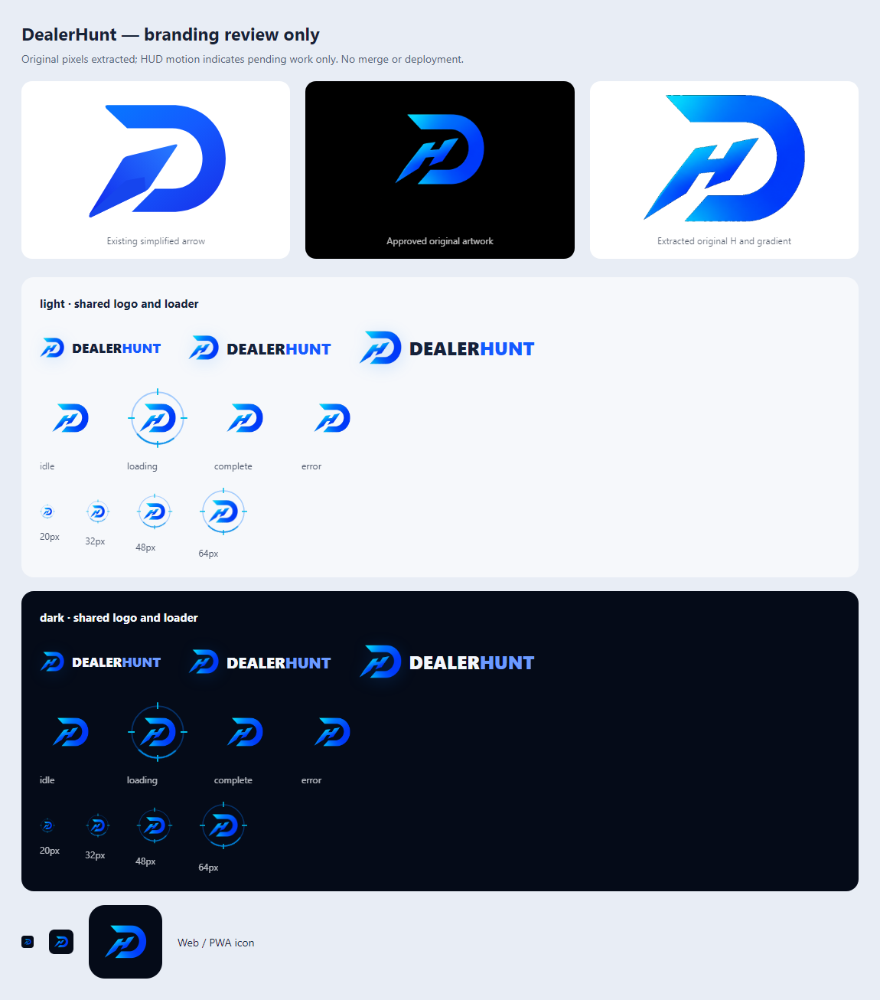

# DealerHunt branding review

Worktree: `C:/Users/VCTRYSESN/.codex/worktrees/dh-brand-review/MikeHunt`

Branch: `codex/dh-brand-review`, based on `1543f5451e4d742ce671aca104436ea2a36815b5`.
Review-only: no merge, deployment, or ADB use. Main/shared source files were not edited.
The repository disables Vercel deployments for non-main branches; that configuration is unchanged.

## Approved artwork

The previous SVG replaced the reference's slanted H with an arrow and changed its
cyan-to-blue gradient. This change extracts original pixels from the approved
`C:/Users/VCTRYSESN/Downloads/Refined Slanted Diamond Logo.png` (1254 × 1254).
The HUD inspiration was `DealerHunt Neon Automotive HUD Branding.png` in Downloads.
No image generation, manual redraw, tracing, or gradient replacement was used.

Source SHA-256: `d56bf4139e641be0a65f792d097e7e0593ee6067f2ce2878b290780737b24628`.
Crop: left 300, top 306, width 648, height 512. Background extraction retains pixels
where blue > 30 and blue − red > 20, preserving original RGB samples. Pixel comparison
found 153,064 retained pixels, zero changed RGB samples, and no crop-edge artwork.
The local self-contained SVG embeds the transparent PNG. Existing logo components
already reference this SVG. Web/PWA icons use the same crop on a dark tile, within
the maskable safe circle.

## Anti-flash and authentic request lifecycle

Accessible task text mounts immediately. The shared component hides only decorative
artwork for the first 200 ms of each continuous pending interval. From 200 through
999 ms, the HUD is at most 32 px; at 1000 ms it uses the caller's requested size.
Requests start immediately and results/errors render immediately, even for requests
that settle before 200 ms. Visual timers are cancelled on settlement/unmount, and
retries start a fresh guard. The page's old 220 ms guard is replaced by this shared
guard so the accessible pending status is not delayed.

The status live region omits aria-busy, which could defer announcements. All
artwork is decorative. Task text is neutral and does not describe invented backend
stages. There are no percentages, fake progress, minimum duration, or finish delay.

## Four visual beats

The 4.8-second indeterminate loop is CSS-only and runs while the request is genuinely
pending and the 200 ms visual guard has expired. The original mark never changes
geometry or gradient. Each beat is purely decorative:

| Beat     | Visual treatment                                                   |
| -------- | ------------------------------------------------------------------ |
| Scan     | Arc sweeps once around the stationary mark                         |
| Discover | Thin cyan line sweeps across the HUD                               |
| Evaluate | Four framing brackets briefly draw attention to the mark           |
| Reveal   | Restrained glow around the original artwork, then back to the loop |

These names appear only in code/documentation, not task status text. Reveal is not
completion: the loop stays pending until actual settlement. Completion or error
interrupts any beat immediately and displays the static mark. Reduced motion
removes all four animations and keeps a static HUD after the same anti-flash guard.

## Startup acceptance — explicitly not implemented

The first-session startup requirement (maximum 1300 ms, immediate stop on usable
content, skip repeats) is **not implemented or validated**. The inspected branch
has no shared blocking client initialization owner or `app/(dashboard)/loading.tsx`.
Its shell/providers render children immediately; real server-side and route-local
waits remain separate. MobileSplashScreen is an unused export without a duration
cap or first-session guard. The request-loader timings and four visual beats do
not establish startup acceptance.

[Startup architecture audit and acceptance matrix](brand-review/startup-acceptance.md)
· [Machine-readable findings](brand-review/startup-acceptance.json).

No runtime changes were made for this finding. No fake splash or content delay
was added. The full-gate results below apply to the unchanged application-code
commit `03612d61761820a5bedd762d15037d990df1ea61`, not a claimed startup integration.

## Clean build and stale generated types

The earlier 15 route/page errors came from stale `.next/types/app/...` validators.
That diagnosis is superseded by the successful clean default Next.js 16 build.
No unrelated route exports or signatures were changed to suppress the errors.

Before cleanup, `.next` was verified as a normal directory under the isolated
branding worktree, with no Node server using that worktree. Automatic approval
review rejected native PowerShell deletion with “blocked by policy.” A reversible
native PowerShell literal-path move removed the old output from the project tree
instead. It is retained at
`C:/Users/VCTRYSESN/.codex/worktrees/dh-brand-review/stale-next-20261105`.
Both source and archive paths were verified before moving. No shared output was touched.

A clean default build first exposed the worktree's external dependency junction.
The junction was moved intact to ignored `.cache/shared-dependency-link`, and
private dependencies were copied into this worktree's node_modules. The shared
node_modules directory was read only. No tracked configuration changed.

Fresh `npm run build` with private dependencies **passed**, including TypeScript and
66 static pages. It generates `validator.ts`, `routes.d.ts`, `root-params.d.ts`, and
`cache-life.d.ts`, without the stale `types/app` fixtures. Existing build notices
include React 18 deprecation and broad filesystem tracing in an unrelated scraper.

## Validation and evidence

- Targeted tests: **30 passed**, four files, covering immediate accessible status,
  199/200 ms and 999/1000 ms boundaries, short/long requests, success/error, retry,
  timer cleanup, neutral text during repeated motion, and genuine settlement.
- Chromium: 16 state/size/theme cases; all four decorative beat styles verified;
  unchanged neutral text during every beat; immediate interruption on settlement
  from each beat; zero animations under reduced motion.
- Pixel extraction: 153,064 retained pixels, zero changed RGB samples, zero crop-edge pixels.
- Clean default production build: passed.
- Full `npm run verify` gate: **passed** — typecheck, lint (zero errors; 193 warnings), **5887 tests in 776 files**, and default production build. The complete gate took 772.5 seconds; all checks remained enabled.
- Production audit: passed, zero high/critical findings (6 low, 6 moderate).

A compact machine-readable summary is included at `docs/brand-review/validation.json`.

Local evidence directory: `test-results/dh-brand-review/` (ignored output).

| Evidence                    | Path relative to worktree                                                         |
| --------------------------- | --------------------------------------------------------------------------------- |
| Fresh clean build           | `test-results/dh-brand-review/clean-private-build.log`                            |
| Complete local gate         | `test-results/dh-brand-review/full-verify.log`                                    |
| Production dependency audit | `test-results/dh-brand-review/production-audit.log`                               |
| Targeted tests              | `test-results/dh-brand-review/choreography-tests.log`                             |
| Browser checks              | `test-results/dh-brand-review/browser-checks.json`                                |
| Browser command output      | `test-results/dh-brand-review/choreography-browser.log`                           |
| Pixel comparison            | `test-results/dh-brand-review/followup-pixel-check.json`                          |
| Hidden before 200 ms        | `test-results/dh-brand-review/branding-before-200ms.png`                          |
| Compact at 200 ms           | `test-results/dh-brand-review/branding-compact-200ms.png`                         |
| Long-wait overview          | `test-results/dh-brand-review/branding-review.png`                                |
| Individual beats            | `test-results/dh-brand-review/branding-phase-{scan,discover,evaluate,reveal}.png` |
| Reduced motion              | `test-results/dh-brand-review/branding-reduced-motion.png`                        |
| Motion recording            | `test-results/dh-brand-review/branding-motion.webm`                               |

Earlier `followup-build.log`, `followup-status.json`, and `build-failures.json` are
historical failed runs and do not describe the clean build's current result.

Reproduce artwork/preview from this worktree:

```powershell
node scripts/extract-dealerhunt-reference.mjs 'C:/Users/VCTRYSESN/Downloads/Refined Slanted Diamond Logo.png'
node scripts/generate-dealerhunt-icons.mjs
node scripts/preview-dealerhunt-brand.mjs 'C:/Users/VCTRYSESN/Downloads/Refined Slanted Diamond Logo.png'
npm run verify
node scripts/audit-production-dependencies.mjs
```

## Review media

These selected captures are also included in the branch for remote review:



[Compact HUD at 200 ms](brand-review/branding-compact-200ms.png) ·
[Reduced-motion capture](brand-review/branding-reduced-motion.png) ·
[Motion recording](brand-review/branding-motion.webm)

## Changed paths

- `app/(dashboard)/deal-check/page.tsx`
- `app/dealerhunt-loader.test.tsx`
- `app/offer-review-workflow.test.ts`
- `components/brand/MikeHuntLoader.module.css`
- `components/brand/MikeHuntLoader.tsx`
- `docs/brand-review/branding-review.png`
- `docs/brand-review/branding-compact-200ms.png`
- `docs/brand-review/branding-reduced-motion.png`
- `docs/brand-review/branding-motion.webm`
- `docs/brand-review/startup-acceptance.md`
- `docs/brand-review/startup-acceptance.json`
- `docs/brand-review/validation.json`
- `docs/dh-brand-review.md`
- `public/apple-touch-icon-120x120.png`
- `public/apple-touch-icon-152x152.png`
- `public/apple-touch-icon-180x180.png`
- `public/apple-touch-icon.png`
- `public/brand/DEALERHUNT-D.png`
- `public/brand/DEALERHUNT-D.svg`
- `public/dealerhunt-icon.svg`
- `public/favicon-16x16.png`
- `public/favicon-32.png`
- `public/favicon-32x32.png`
- `public/favicon.ico`
- `public/icon-128x128.png`
- `public/icon-192x192.png`
- `public/icon-256x256.png`
- `public/icon-384x384.png`
- `public/icon-512x512.png`
- `public/icon-96x96.png`
- `public/icon-maskable-192x192.png`
- `public/icon-maskable-512x512.png`
- `public/icon.svg`
- `scripts/extract-dealerhunt-reference.mjs`
- `scripts/generate-dealerhunt-icons.mjs`
- `scripts/preview-dealerhunt-brand.mjs`

## Limitations

The SVG embeds raster artwork, so it is not an infinitely scalable vector. The PNG
is about 195 KB and shared SVG about 260 KB. The original black matte limits edge
antialiasing; fine detail is limited at favicon sizes. The legacy Safari pinned-tab
mask is unchanged pending approved vector artwork. Safari/iOS installation and a
full authenticated app session were not tested. Screenshots use the actual shared
components/CSS Modules in an isolated browser harness with minimal layout utilities.
Motion tests validate the visual contract, not screen-reader speech output.
